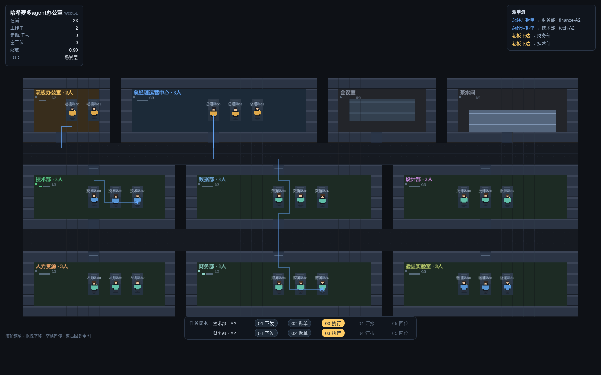

# 哈希麦多 agent 办公室（Hashmai Multi-Agent Office）

> 把一个公司的组织架构画进一张可交互的办公室地图：老板办公室下达命令，总经理运营中心接单，
> HR / 财务 / 技术 / 数据 / UI / QA 各部门 ≤3 个工位，agent 在工位间走动、接单、回报。
>
> 视觉骨架沿用像素办公室（pixel-office）风格，渲染层自研为 **PixiJS 8 + 原生 JS**，
> 单页零构建依赖、可完全离线打开。



---

## 这是什么

一个**多 agent 实时监控面板**：不是抽象的后台表格，而是一间公司。每条任务都从「老板办公室」出发，
经「总经理运营中心」分派到具体部门的具体工位，agent 在图上走过去、坐下、干活、回报，最后回到工位待命。
面板上看到的是**谁在哪、在干什么、这条线走到第几步**，而不是一串日志。

**当前能力**

| 能力 | 状态 |
| --- | --- |
| 10 个场景区域（老板办公室 / 运营中心 / 会议室 / 茶水间 / 技术 / 数据 / UI / HR / 财务 / QA 实验室） | 已实现 |
| 23 个工位（老板 2 + 7 部门 × 3），编号与工位牌统一 | 已实现 |
| 任务流水条：事件 → 动作对照，按工位两行并排显示 | 已实现 |
| WebGL 优先 / Canvas2D 自动降级（`?force2d=1` 强制） | 已实现 |
| LOD 分档、镜头跟随、空席可见性、首帧 HUD 立即计数 | 已实现 |
| 自检模式 `?selfcheck=1`：页面内输出可机读 JSON | 已实现 |
| 单文件验收版（内联依赖，双击即开，无需服务器） | 已实现 |
| 接真实事件流（store）+ 点席位查详情 + 30 秒回放 | 规划中 |

当前版本 **v0.8**（改名「哈希麦多 agent 办公室」+ 首帧 HUD 修复）。

---

## 快速开始

### 方式一：直接打开（推荐给评审）

仓库根目录起一个静态服务器，浏览器打开 `/demo/office-demo.html`：

```bash
git clone https://github.com/hashmai/hashmai-agent-office.git
cd hashmai-agent-office
python3 -m http.server 8080
# 浏览器打开 http://localhost:8080/demo/office-demo.html
```

> 直接双击 `demo/office-demo.html` 也能跑（脚本与素材都是相对路径），
> 但部分浏览器会因 `file://` 限制读不到 `../assets` 与 `./lib`，所以推荐上面的方式。

**常用 URL 参数**

| 参数 | 作用 |
| --- | --- |
| `?selfcheck=1` | 跑完一帧后把自检结果写进页面 `<pre id="sc-json">` |
| `?force2d=1` | 强制走 Canvas2D（验证降级路径） |
| `?static=1` | 冻结动画，用于截图比对 |
| `?tasks=2&adv=240` | 预置 2 条流水任务，推进 240 帧（演示用） |

### 方式二：单文件版（零依赖验收入口）

`demo/office-demo-single.html`（约 737 KB）把 PixiJS、`sim.js`、贴图全部内联，双击即开、
不需服务器、不需同目录其它文件。用于「只拿到一个 html 也要能看」的场景。

### 方式三：从源码重建

```bash
python3 tools/build_office.py        # 地图 TMAP
python3 tools/build_seatmodel.py     # 席位模型 seat-model.json
python3 tools/build_tiles.py         # 贴图集 assets/office-tileset.png
python3 tools/build_sprites.py       # 角色精灵 assets/agents.png
python3 tools/build_demo.py          # 组装 demo/office-demo.html（模板 + 注入数据）
python3 tools/build_single_file.py   # 打自包含单文件版
node tools/test_sim.js               # 状态机单测
python3 tools/check_seat_ids.py --require-unified   # 工位编号一致性
```

依赖：**Python 3.10+**、**Node 18+**（无 npm 依赖，无 pip 依赖）。
构建脚本有顺序依赖，请按上面顺序执行。

---

## 校验与验收

```bash
node tools/test_sim.js                              # 9/9 通过
python3 tools/check_seat_ids.py --require-unified   # seats=23 zones=8 fail=0
python3 tools/contract_selftest.py                  # 契约自测：verdict=PASS
```

`schema_validated` 一项需要 `jsonschema`：装了就走严格校验，没装则显式 **SKIP**
（不会把 verdict 拉成 FAIL，clone 到干净机器照样绿）。想开严格校验：

```bash
python3 -m pip install -r requirements-dev.txt
```

CI（`.github/workflows/ci.yml`）在每次 push / PR 时跑上述两项，外加
「模板能重建出与仓库内 `demo/office-demo.html` 一致的产物」的比对。

**性能基线（第三方复测，1600×800 视口，WebGL2 / ANGLE Metal M5）**

| 指标 | 值 |
| --- | --- |
| 帧率 | 60.0 fps |
| p50 / p95 / p99 / max 帧时 | 16.7 / 16.8 / 16.8 / 16.8 ms |
| 慢帧（>20ms） | 0 |
| 渲染侧单帧成本 | 0.14 ms |

判据框架 P98（功能 / 工具 / 结构 / 数据 / 性能 / UI 六维，10 分制）见
[`ROOST-GAP-BOARD.md`](ROOST-GAP-BOARD.md) 与外部判据器项目 `p98-criteria-01`。

---

## 目录结构

```
.
├── demo/
│   ├── office-demo.template.html   源码模板（占位符 + 注入点）
│   ├── office-demo.html            构建产物（可直接打开）
│   ├── office-demo-single.html     自包含单文件版（产物）
│   ├── lib/pixi.min.js             内置 PixiJS 8.6.6（离线可用）
│   ├── sim.js                      状态机与寻路（纯逻辑，可单测）
│   └── shots/                      各版本渲染截图（文档用）
├── assets/                         贴图集、角色精灵、地图 TMJ、生成报告
├── tools/                          构建 / 校验 / 压测脚本
├── patches/                        历史补丁（按序应用，可 -R 回滚）
├── *.md                            设计文档、判据看板、证据记录
├── .github/                        CI、Issue/PR 模板、CODEOWNERS
├── CONTRIBUTING.md  SECURITY.md  CODE_OF_CONDUCT.md  CHANGELOG.md
└── package.json  LICENSE
```

### 关键文档

| 文件 | 内容 |
| --- | --- |
| [`ROOST-UI-ARCH-01.md`](ROOST-UI-ARCH-01.md) | 整体 UI 架构与渲染分层 |
| [`OFFICE-MAP-01.md`](OFFICE-MAP-01.md) | 地图分区、可行走格、相机与 LOD |
| [`SEAT-ID-MAP.md`](SEAT-ID-MAP.md) | 工位编号规范（牌面 = seat_id） |
| [`DEMO-V01.md`](DEMO-V01.md) | Demo 迭代记录（v0.1 → v0.8） |
| [`BATCH-MERGE-RUNBOOK.md`](BATCH-MERGE-RUNBOOK.md) | 补丁批次、合入与回滚 runbook |
| [`ROOST-GAP-BOARD.md`](ROOST-GAP-BOARD.md) | 六维判据差距看板 |
| [`CONTRACT-01.md`](CONTRACT-01.md) | 对外契约（事件 schema / 席位模型） |
| [`D5-DEST-SHARED-ROUTE.md`](D5-DEST-SHARED-ROUTE.md) | 目的地共享寻路与 30/50 agent 压测 |
| [`D6-FPS-EVIDENCE-0170BE02.md`](D6-FPS-EVIDENCE-0170BE02.md) | 帧率第三方实测证据 |

---

## 设计要点（为什么长这样）

- **公司空间化，而不是列表化**：老板 → 运营中心 → 部门的物理动线就是任务的流转路径，
  一眼能看出瓶颈在派单、在部门、还是在回报。
- **一部门 ≤3 工位**：超过 3 个并排工位在 1600 宽视口下就挤成一排像素点，
  所以编制按「老板 2 + 7 部门 × 3 = 23」封顶，扩编走第二层楼。
- **单文件可验收**：评审环境常常没有 Node、没有网络、只有一个浏览器。
  单文件版把所有依赖变成 data URI，`build_single_file.py` 会在锚点缺失或重复时直接拒绝产出。
- **自检可机读**：`?selfcheck=1` 输出 JSON，供 CI / 第三方脚本取值，避免「我看到是好的」这种口头验收。

---

## 参与贡献

欢迎 issue 与 PR。动手前请先读 [`CONTRIBUTING.md`](CONTRIBUTING.md)；
本项目遵循 [`CODE_OF_CONDUCT.md`](CODE_OF_CONDUCT.md)；安全问题请按 [`SECURITY.md`](SECURITY.md) 私密上报。

## 许可

代码以 [MIT License](LICENSE) 发布。
仓库内 `demo/shots/` 下的截图由本项目渲染产出，随同 MIT 授权；
第三方依赖与素材的许可见 [`THIRD-PARTY-NOTICES.md`](THIRD-PARTY-NOTICES.md)。

「哈希麦 / Hashmai」名称与标识不在 MIT 授权范围内（商标保留）。

## 免责

本项目是可视化监控前端示例，不包含任何交易、风控或投顾逻辑；
仓库内不存放任何账号、密钥或真实业务凭据。
